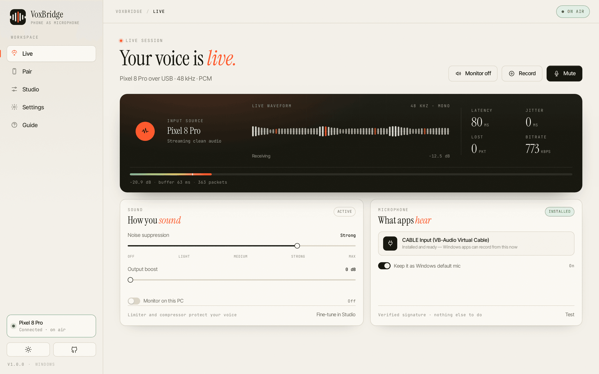
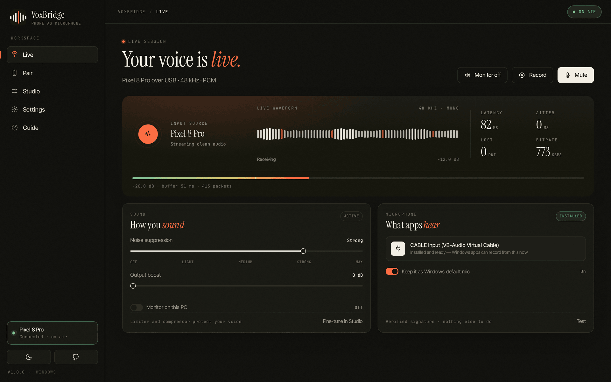
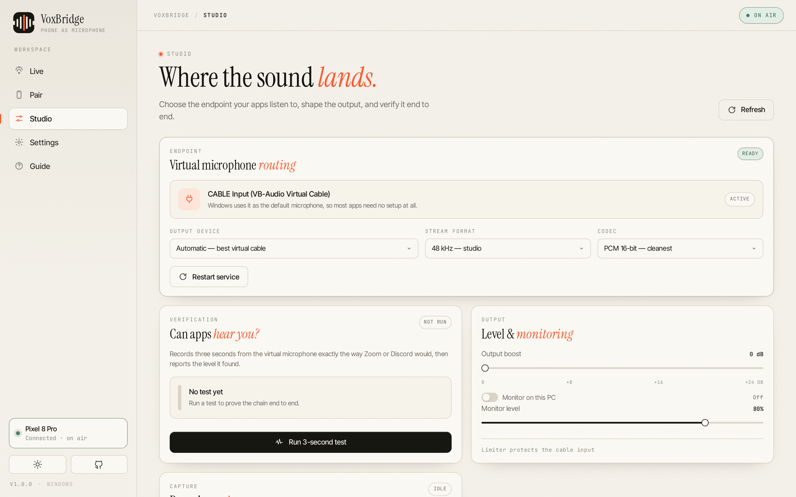
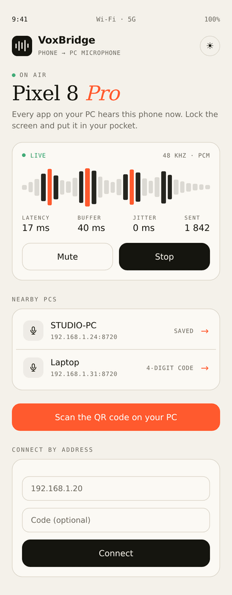
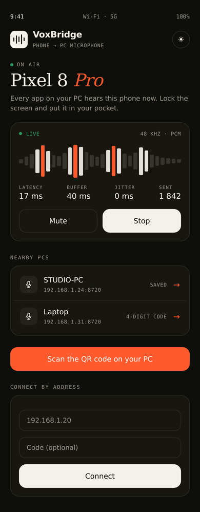

<div align="center">



# VoxBridge

**Turn your phone into a studio microphone for Windows.**

No account · No cloud audio · No kernel driver to break your PC

[**Download**](https://voxbridge-mic.vercel.app/download) ·
[Website](https://voxbridge-mic.vercel.app) ·
[Setup guide](https://voxbridge-mic.vercel.app/setup) ·
[Privacy](https://voxbridge-mic.vercel.app/privacy) ·
[Security model](SECURITY.md)

[](https://github.com/sdlksdsf/VoxBridge/releases/latest)
[](https://github.com/sdlksdsf/VoxBridge/actions/workflows/desktop.yml)
[](https://github.com/sdlksdsf/VoxBridge/actions/workflows/android.yml)
[](https://github.com/sdlksdsf/VoxBridge/actions/workflows/ios.yml)
[](LICENSE)
[](https://github.com/sdlksdsf/VoxBridge/releases)

**Install in one step:** [voxbridge-mic.vercel.app/download](https://voxbridge-mic.vercel.app/download) —
the site picks the right file for your device (`.exe` on Windows, `.apk` on Android, `.ipa` on iPhone) and
serves it from its own domain, so a phone never has to wrestle with a GitHub redirect.

New in **1.0.1**: the Android stream now survives a locked screen, and phone downloads no longer stall.
See [CHANGELOG.md](CHANGELOG.md).

</div>

---

A laptop microphone picks up the room, the keyboard, and you — in that order. The microphone on the phone in
your pocket is genuinely better. VoxBridge is the boring part in between: a native Windows capture service, a
real Android and iOS app, and a voice chain that is honest about what it does.

Point the phone at the PC. Speak. Every app that accepts a microphone — Zoom, Teams, Discord, OBS, Steam,
Chrome — hears you, cleanly, in about 60 ms.

<table>
<tr>
<td width="50%"></td>
<td width="50%"></td>
</tr>
<tr>
<td align="center"><sub><b>Live session</b> — level, latency, jitter, packet loss</sub></td>
<td align="center"><sub><b>Studio</b> — endpoint, format, and a real three-second test</sub></td>
</tr>
</table>

## Contents

- [Why this exists](#why-this-exists)
- [Features](#features)
- [Download](#download)
- [How it works](#how-it-works)
- [Sound quality, measured](#sound-quality-measured)
- [The phone app](#the-phone-app)
- [Compatibility](#compatibility)
- [Build from source](#build-from-source)
- [Repository layout](#repository-layout)
- [Security and privacy](#security-and-privacy)
- [Contributing](#contributing)
- [License](#license)

## Why this exists

Most phone-as-microphone tools stop at "audio arrives somewhere". You install a driver, pick a device in a
meeting, hear nothing, and have no idea which of the five steps failed.

VoxBridge does three things differently:

1. **It proves the chain works.** The Studio screen records three seconds from the *virtual cable's output* —
   exactly what Zoom will receive — and reports the level it captured. If it is silent, you know before your
   meeting, not during it.
2. **It makes Windows pick the cable up for you.** On connect it sets the virtual cable as the default
   recording device, then hands your original microphone back when you disconnect. Discord and Chrome read
   that default; without it they keep recording the laptop.
3. **It ships a real voice chain, not a gain slider.** Decision-directed noise suppression, a hysteresis gate,
   auto gain that freezes in silence, presence and warmth EQ, a soft-knee compressor and a lookahead limiter.

## Features

| | |
|---|---|
| **Connection** | Automatic LAN discovery · QR pairing from the phone · nearby-PC list · manual address · USB via `adb reverse` · 4-digit pairing code · remembered devices |
| **Capture** | 48 / 32 / 24 / 16 kHz · PCM16 or IMA ADPCM · 10 or 20 ms frames · adaptive jitter buffer that grows on packet loss · short, faded concealment · duplicate-frame rejection |
| **Cleaning** | Decision-directed spectral suppression (4 levels) · 80 Hz high-pass · hysteresis noise gate · auto gain · presence EQ · warmth shelf · soft-knee compressor |
| **Output** | +24 dB boost · lookahead limiter with −1 dBFS ceiling · one-click monitor switch in the Live header (off by default) · 16-bit WAV session recording |
| **Voice changer** | 25 characters · independent pitch (±16 st) and formant warping · 34 procedural troll pads mixed into the microphone · no download, no API key, no licence |
| **Windows** | Native WASAPI capture service · virtual-mic detection and auto-claim · three-second verification test · per-user installer · portable ZIP · background operation · autostart · diagnostics export |
| **Android** | Foreground service with mute and gain actions · live notification · on-device DSP · light and dark themes · Android 8+ |
| **iOS** | SwiftUI app · background audio session · Accelerate DSP · same protocol and presets · iOS 16+ |
| **Website** | Download hub · setup guides · privacy policy · terms · security model · Supabase-backed anonymous download counters |

## Download

Every build below is produced by GitHub Actions from this repository and published to
[Releases](https://github.com/sdlksdsf/VoxBridge/releases/latest). Checksums are in
[`SHA256SUMS.txt`](https://github.com/sdlksdsf/VoxBridge/releases/latest/download/SHA256SUMS.txt).

| Platform | Requirements | File |
|---|---|---|
| **Windows 10 / 11** | 1809+, x64, ~400 MB | [`VoxBridge-Setup-1.0.1-x64.exe`](https://github.com/sdlksdsf/VoxBridge/releases/latest/download/VoxBridge-Setup-1.0.1-x64.exe) |
| **Windows portable** | Same, no install | [`VoxBridge-1.0.1-win64-portable.zip`](https://github.com/sdlksdsf/VoxBridge/releases/latest/download/VoxBridge-1.0.1-win64-portable.zip) |
| **Android** | 8.0+ | [`VoxBridge-1.0.1-android.apk`](https://github.com/sdlksdsf/VoxBridge/releases/latest/download/VoxBridge-1.0.1-android.apk) |
| **iOS** | 16+, unsigned | [`VoxBridge-1.0.1-unsigned.ipa`](https://github.com/sdlksdsf/VoxBridge/releases/latest/download/VoxBridge-1.0.1-unsigned.ipa) |

> **A note on signatures.** The Windows binaries are not code-signed, so SmartScreen will ask once. The IPA is
> unsigned because a signing identity is tied to your Apple ID; use AltStore, Sideloadly or Xcode. Both are
> covered step by step in the [setup guide](https://voxbridge-mic.vercel.app/setup).

### The virtual microphone

Windows applications cannot record from an app — they record from an audio endpoint. VoxBridge renders into
[VB-CABLE](https://vb-audio.com/Cable/), a well-known virtual audio device, and then tells Windows to use the
cable's output as the default microphone.

If VB-CABLE is missing, VoxBridge offers to fetch the official installer from `vb-audio.com`, verifies its
Authenticode signature, and runs it. Once the cable is detected, the app remembers it and **stops asking**.

## How it works

```
  ┌──────────────┐        PCM16 / ADPCM          ┌───────────────────┐
  │   Phone      │  ───────────────────────────▶ │  VoxBridge host   │
  │  AudioRecord │     20 ms frames over WS      │  (Node + UI)      │
  │  + on-device │                               │                   │
  │      DSP     │ ◀───────── telemetry ──────── │  jitter buffer    │
  └──────────────┘                               │  + AudioWorklet   │
                                                 └─────────┬─────────┘
                                                           │ processed PCM
                                                           ▼
                                                 ┌───────────────────┐
                                                 │ VoxBridgeMic.exe  │
                                                 │ WASAPI → CABLE    │
                                                 └─────────┬─────────┘
                                                           ▼
                                          CABLE Output  ──▶  Zoom, Discord, OBS…
```

1. The phone captures audio, optionally cleans it, and sends 20 ms frames over WebSocket.
2. The desktop buffers them against jitter, runs the voice chain in an `AudioWorklet`, and hands 20 ms of
   processed PCM to the native service.
3. The native service renders it to the virtual cable with WASAPI shared mode and automatic rate conversion,
   so any endpoint works.
4. On connect, the service sets the cable's capture endpoint as the Windows default microphone and restores
   your previous one on exit.

The wire format is documented in [`docs/PROTOCOL.md`](docs/PROTOCOL.md).

## Sound quality, measured

Claims are cheap. These numbers come from the offline harness used during development, comparing the previous
chain with the current one on the same inputs (180 Hz harmonic speech fixture, room tone at −52 dBFS):

| Measurement | Before | After |
|---|---|---|
| THD, default chain | 1.92 % | **0.01 %** |
| THD at +24 dB boost | 2.00 % | **0.00 %** |
| Voice retained through the denoiser | 46.9 % | **98.5 %** |
| Room tone rejected | 8.2 dB | **13.8 dB** |

Three things drove that:

- **The boost moved before the compressor.** It used to be applied after compression and immediately clamped,
  which is what made loud syllables crunchy. Now a soft-knee 3:1 compressor handles the gain and a lookahead
  limiter attenuates transients *before* they reach the output.
- **The denoiser learned the wrong noise floor.** It seeded with a running maximum, so it converged to the
  speech peaks and subtracted the voice. The estimate is now speech-gated: it freezes while someone is talking
  and converges in the pauses, with spectral over-subtraction and decision-directed a priori SNR on top. Measured
  room-tone rejection is 16 dB with about 1 dB lost from the voice.
- **The overlap-add was not COLA.** Hann analysis × Hann synthesis at 50 % overlap double-counts, modulating the
  output at the frame rate. Square-root Hann on both sides sums to exactly one.

The phone runs the same chain in Kotlin (`apps/android/.../audio/Dsp.kt`) and no longer enables the platform's
own noise suppressor or AGC on top of it, which was the cause of the hollow, "underwater" sound on Android.

## The phone app

<table>
<tr>
<td width="30%"></td>
<td width="30%"></td>
<td valign="top">

**One screen, no menus.**

- On air or not, at a glance
- Level, latency, buffer, jitter, packets sent
- Mute and stop without unlocking anything else
- Nearby PCs, or scan the QR code shown on the PC
- Manual address and pairing code when discovery is blocked
- USB mode for the flattest path

</td>
</tr>
</table>

## Compatibility

Any Windows application that records from a standard microphone works once the cable is the default input:
Zoom, Microsoft Teams, Discord, Google Meet, Slack Huddles, OBS Studio, Streamlabs, Audacity, Reaper, Steam
Voice, Valorant, Fortnite, CS2, Windows Voice Recorder and Chrome. Names are trademarks of their owners and are
listed only to describe compatibility.

Latency, on 5 GHz Wi-Fi 6 at 48 kHz PCM with 20 ms frames and a 60 ms buffer, is typically 60–90 ms end to end:
20 ms capture, 3–12 ms network, 60 ms adaptive buffer, 18–30 ms desktop DSP and WASAPI. USB removes the network
term.

## Build from source

Requires Node 20+, Python 3.11+ and, for the Windows pieces, a C++17 compiler (MSVC or the bundled
`ziglang` toolchain used in CI).

```bash
# Desktop app + installer (cross-compiles the native service with zig)
cd apps/desktop/standalone
ZIG=$(python3 -c "import ziglang,os;print(os.path.join(os.path.dirname(ziglang.__file__),'zig'))") \
  ./build-windows.sh

# Android
cd apps/android && gradle assembleRelease

# iOS (macOS + Xcode)
cd apps/ios && xcodegen generate && \
  xcodebuild -scheme VoxBridge -sdk iphoneos -configuration Release CODE_SIGNING_ALLOWED=NO
```

Full instructions, including how the release pipeline publishes assets, are in [`docs/BUILD.md`](docs/BUILD.md).

## Repository layout

```
apps/desktop          Electron host, React-free renderer, DSP worklet, native WASAPI service (C++)
apps/android          Kotlin + Jetpack Compose app, foreground service, on-device DSP
apps/ios              SwiftUI app, URLSession WebSocket, Accelerate DSP
apps/web              Marketing site, download hub and legal pages (Vercel)
packages/protocol     Wire format notes and golden vectors
packages/supabase     Schema, row-level security policies and RPCs
docs                  Architecture, protocol, privacy, build and release documentation
```

## Security and privacy

- Audio travels directly between your phone and your PC over the local network. There is no relay, no account
  and no cloud processing.
- The receiver binds to the LAN only. The phone must present the four-digit pairing code, and a device can be
  remembered with a hashed token.
- The only download VoxBridge performs is the official VB-CABLE installer, from `download.vb-audio.com`, with
  its Authenticode signature checked before execution.
- The website stores anonymous download counts. It never stores audio.

Read the [privacy policy](https://voxbridge-mic.vercel.app/privacy) and [security model](SECURITY.md). To
report a vulnerability, follow [`SECURITY.md`](SECURITY.md) rather than opening a public issue.

## Contributing

Issues and pull requests are welcome — see [CONTRIBUTING.md](CONTRIBUTING.md). Before opening a PR, run the
build for the platform you touched; a PR is expected to keep the Desktop, Android and iOS workflows green.

```bash
node scripts/lint.js                             # website references + JS syntax
cd apps/desktop && npm install && npm start      # runs the desktop host
cd apps/android && gradle assembleDebug          # compiles the Kotlin app
```

If VoxBridge replaced a microphone for you, a star helps other people find it — that is the whole
marketing budget.

## License

MIT — see [LICENSE](LICENSE). VoxBridge is an independent project and is not affiliated with VB-Audio,
VoiceMeeter, WO Mic or Microsoft.
